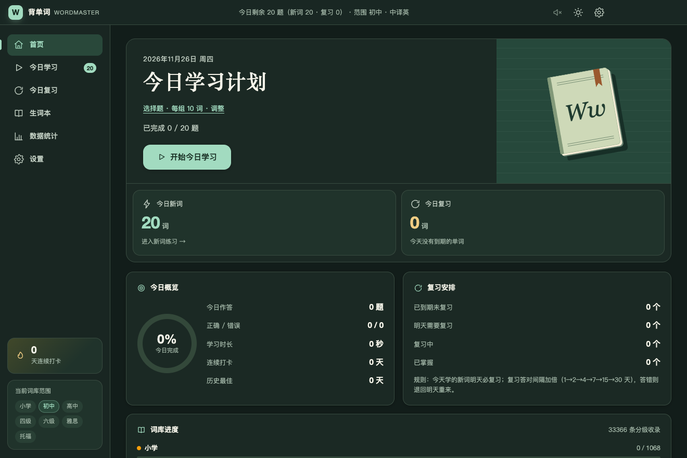

**English** | [中文](README.md)

# WordMaster

An offline vocabulary trainer for Windows and Android, with multiple-choice questions, spelling practice, spaced reviews, bookmarking, bilingual entry cards, light/dark themes and local JSON backups.



## Android 2.0.0

[Download the APK](WordMaster-Android.apk), requiring Android 8.0 or later. It uses the same signing key as 1.x, with versionCode 4. Install over the previous version to retain progress. Uninstalling deletes local data.

The new adaptive launcher icon combines a forest-green background, open book and W monogram, including an Android 13 monochrome layer. Android hides desktop keyboard prompts at every screen size.


## Rebuilt vocabulary

One shared lexicon now holds **11,100 distinct entries**, referenced by **33,366 level records**:

| Bank | Records |
| --- | ---: |
| Primary / CEFR-J A1 reference | 1,068 |
| Junior | 1,773 |
| Senior | 3,790 |
| CET-4 | 5,388 |
| CET-6 | 7,133 |
| IELTS | 5,919 |
| TOEFL | 8,295 |

Exam banks use ECDICT tags plus foundational vocabulary. Banks overlap and are learning references, not exhaustive official syllabuses. The Primary bank references CEFR-J A1 rather than a Chinese primary-school curriculum.

Entries include a concise quiz gloss, detailed senses separated by part of speech, sourced pronunciation, and word forms where available. US IPA is preferred; British fallback pronunciation is labeled. Reviewed corrections are stored separately from the source snapshots.

There are **1,648 distinct bilingual corpus examples**, selected conservatively from Tatoeba/ManyThings and retaining sentence IDs and contributor attribution. Not every entry has an example. Full data notices are bundled in Settings and in [THIRD_PARTY_NOTICES.txt](docs/THIRD_PARTY_NOTICES.txt).

Choice questions filter distractors that overlap with any sense of the answer. Spelling offers a first-letter cue and accepts listed regional variants. On upgrade, existing review dates, answer counts and bookmarks survive; retired words remain available for reviewing existing records.

Data sources: [ECDICT](https://github.com/skywind3000/ECDICT), [CEFR-J](https://github.com/openlanguageprofiles/olp-en-cefrj), [ipa-dict](https://github.com/open-dict-data/ipa-dict), [Tatoeba/ManyThings](https://www.manythings.org/anki/). See the [audit report](docs/vocabulary-audit.json) for exclusions and example coverage.

## Development

```sh
npm install
npm start
npm run check
npm run rebuild:vocabulary
npm run build:portable
```

The vocabulary rebuild uses Python 3's standard library and pinned offline source snapshots with SHA-256 verification. It produces the shared lexicon, seven catalogs, attributed examples and runtime script. Checks exercise every level entry in both quiz directions, along with backup, migration, spelling and scheduling regressions.

See [Android build instructions](android/README.md). Browser interaction checks, Android build/Lint and signature validation have been completed; physical-device installation has not been verified in this environment.

Application code: [MIT](LICENSE). Third-party datasets retain their own licenses.
