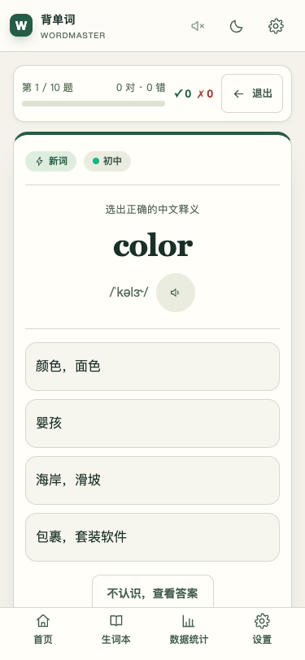
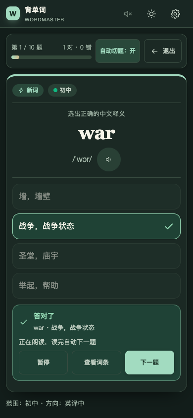

[English](README.en.md) | **中文**

# 背单词 WordMaster

支持 Windows 与 Android 的离线背单词应用：选择题、拼写训练、生词本、复习计划、明暗主题和本地 JSON 备份。


## Android 2.0.2

[下载 WordMaster-Android.apk](WordMaster-Android.apk)，适用于 Android 8.0 及以上版本。

使用与 1.x 相同的签名，版本号 2.0.2 / versionCode 6，可以覆盖安装。学习进度、收藏和复习日期保留；换库后仍有学习记录的旧词可继续复习。请使用覆盖安装，卸载应用会清除本地数据。

新的桌面图标使用森林绿底色、书页与 W 标记，包含自适应前景/背景和 Android 13 单色主题图层。手机、横屏和平板不显示桌面快捷键提示。




英语朗读使用 Android 系统 TTS；离线发音需安装英语语音包。导入导出使用系统文件选择器，备份与 Windows 版互通。构建与签名说明见 [android/README.md](android/README.md)。当前环境未连接 Android 真机，完成的是浏览器操作检查、构建、Lint、资源及签名校验。

## 词库重构

2.0 采用**统一词典＋分级目录**，共 **11100 个不同词条、33366 条分级收录**。同一单词出现在多个等级时共享释义与音标，不再分别维护互相冲突的版本。

| 词库 | 收录数 | 范围依据 |
| --- | ---: | --- |
| 小学 | 1068 | CEFR-J A1 基础参考 |
| 初中 | 1773 | ECDICT 中考标签＋A1 基础 |
| 高中 | 3790 | ECDICT 高考标签＋前级基础 |
| 四级 | 5388 | ECDICT CET-4 标签＋前级基础 |
| 六级 | 7133 | ECDICT CET-6 标签＋四级基础 |
| 雅思 | 5919 | ECDICT IELTS 标签＋基础词 |
| 托福 | 8295 | ECDICT TOEFL 标签＋基础词 |

这是分级学习参考范围，不等同于中国小学课程或官方完整考试词表。各级包含基础词，因此有重叠，收录数不能当作不同单词总数。

- 词条包含简明学习释义、按词性拆分的完整释义、音标及来源，部分词条有词形变化和 CEFR 标注。
- 音标优先采用独立美式 IPA 数据，缺失时保留并标明英式音标。人工修订记录位于 [corrections.json](tools/vocabulary/corrections.json)。
- 例句改用 Tatoeba / ManyThings 的英中语料，按词义相关性和句子长度筛选，保留原句、作者和来源。当前收录 **1648 组不同例句**，并非每个词条都有例句；词条卡可展开署名信息。
- 选择题过滤与答案任一释义重叠的干扰项；拼写训练提供首字母提示，并接受词条列出的英美拼写变体。
- 合并明确的复数/变形记录，剔除缺少可靠音标、词性或需要进一步核查的记录。数量、例句覆盖和剔除理由见 [质量报告](docs/vocabulary-audit.json)。

来源： [ECDICT](https://github.com/skywind3000/ECDICT)、[CEFR-J / Open Language Profiles](https://github.com/openlanguageprofiles/olp-en-cefrj)、[ipa-dict](https://github.com/open-dict-data/ipa-dict)、[Tatoeba 例句](https://www.manythings.org/anki/)。完整署名和许可见 [THIRD_PARTY_NOTICES.txt](docs/THIRD_PARTY_NOTICES.txt)，应用内也可在「设置 → 词库来源与许可」查阅。

## 学习方式

在设置中选择词库、每日新词数、选择题或拼写模式，以及每组 5 / 10 / 20 词或全部任务。默认每组 10 词。

今天学的新词会在次日进入复习。答对按 1、2、4、7、15、30 天延长间隔；答错从次日重新开始。每次答题立即保存，重新打开或调整计划不会补充当天已经完成的新词、复习配额。

默认答对后朗读当前单词一次，读完自动切到下一题，选择题和拼写训练都适用。2.0.2 同时检查朗读回调和播放状态，修复读完仍停留的问题；引擎出错或中断时也会继续。答对后使用紧凑反馈，显示朗读和切题状态，轻触或滑动不会取消自动切题。点击「暂停」或「查看词条」可以停下，再点击「恢复自动」或「下一题」；学习页顶部可直接开关自动切题。答错保留输入并展开详解，切到后台或打开退出弹窗时明确暂停。



故障复现、播放状态策略与回归测试命令见 [答题流程检查](docs/answer-flow.md)。

答对、答错均可查看详细释义、例句和词形，收藏生词或点击朗读；错词会在组内重练。生词本支持搜索、筛选、收藏和掌握进度。电脑端可使用 `1~4` / `A~D` 作答、`Enter` 继续、`S` 朗读、`Esc` 退出。

## 开发与数据维护

```sh
npm install
npm start
npm run check
npm run build:portable
```

维护数据时使用新的来源流程，不再合并旧版的零散词库分片：

```sh
npm run rebuild:vocabulary
```

命令离线读取固定版本的数据快照，验证 SHA-256，重建词库、生成运行脚本并完成检查。Python 3 仅使用标准库。来源版本与校验和保存在 [manifest.json](src/data/sources/manifest.json)。

```text
src/data/lexicon.json       单一词典，每个词条维护一次
src/data/catalog.json       七个等级的词条引用
src/data/examples.json      例句与逐句作者署名
src/data/sources/           固定版本、压缩后的来源快照
src/data/words.js           自动生成，随应用离线分发
tools/vocabulary/           清洗、修订和可重复构建脚本
docs/vocabulary-audit.json  数量、覆盖率与剔除记录
```

`npm run check` 检查词库结构、来源引用和分级完整性，使用真实出题器为全部 33366 条分级记录生成双向题目并排除歧义选项，再运行备份、迁移、拼写与复习调度回归测试。

代码采用 [MIT License](LICENSE)；第三方数据各自保留原许可。
